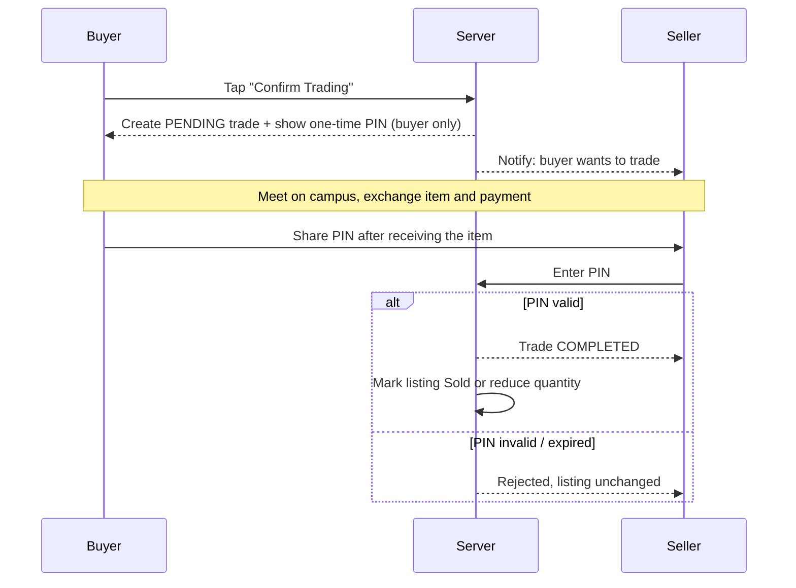
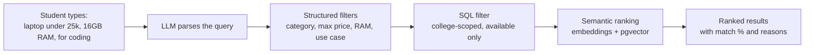
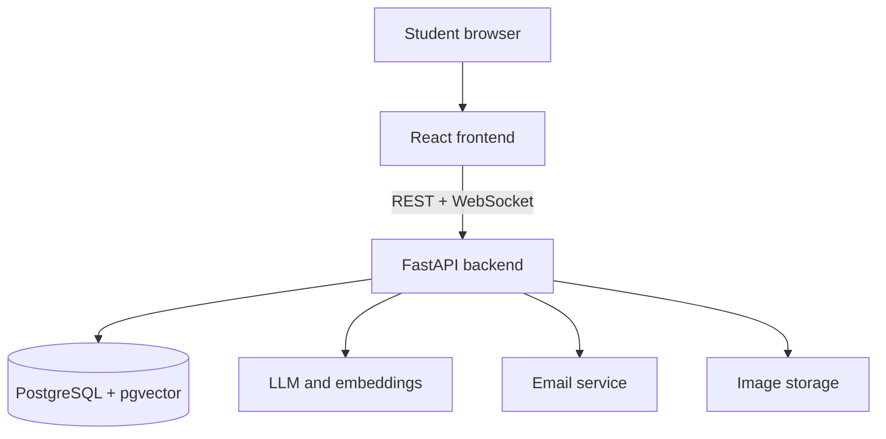

<div align="center">

# 🛒 UniOLX

### Skip scrolling. Just ask.

**The AI-powered, college-only marketplace where students buy and sell second-hand stuff, safely, on their own campus.**


[Live Demo](#) · [Screenshots](#-screenshots) · [How It Works](#-how-the-pin-trade-works) · [Roadmap](#-roadmap)

<!-- Replace with a screenshot or short GIF of your Home page -->


</div>

---

## 💡 The problem

Every semester, seniors graduate and leave behind cycles, laptops, textbooks and hostel furniture, while juniors pay full price for the same things. General marketplaces like OLX are full of strangers, spam and scams, and there's no way to know who you're meeting.

## ✨ The idea

**UniOLX** is a marketplace that only works inside your college. Sign up with your college email, tell the AI what you need in plain English, chat with a verified student from your own campus, meet on campus, and close the deal with a one-time PIN.

> *"Find a second-hand laptop under ₹25,000 with 16 GB RAM for coding."*
> That's the whole search. No filters, no scrolling.

---

## 🚀 Features

| | Feature | What it does |
|---|---|---|
| 🎓 | **College-only access** | Search for your college, sign up with its email, and verify with a 6-digit OTP. Students only ever see listings from their own campus |
| 🤖 | **Campus Buddy (AI search)** | Describe what you want in your own words. The assistant extracts budget, specs and purpose, then ranks matches with clear reasons like "16 GB RAM ✓, ₹22,000 ✓" |
| 💬 | **In-app chat** | Real-time buyer–seller messaging tied to each listing, with unread badges and read receipts |
| 🔐 | **PIN-based trade confirmation** | Payment happens in person. The buyer shares a one-time PIN only after getting the item, and only then does the listing update |
| 🔔 | **Notifications** | Messages, trade requests, completions and cancellations, live in the app |
| 🏷️ | **Smart listings** | Photos, condition, specs, quantity and campus pickup spots, with Available / Reserved / Sold states |
| 🧾 | **Orders and profile** | Track pending and completed trades, manage your listings and wishlist |

---

## 🔐 How the PIN trade works

No online payments, no middleman. The PIN proves the exchange really happened.



**Safeguards:** PINs are generated server-side, stored hashed, limited to 5 attempts, expire automatically, work only for the right seller, and can never be reused. Each trade has its own PIN, and row locking prevents two buyers from claiming the same item.

---

## 🧠 How Campus Buddy works



If the AI is unavailable, search falls back to plain keyword filtering, so it never breaks.

> **Current status:** Campus Buddy runs on the real pipeline: the query is parsed
> by an LLM (Gemini), filtered in SQL against your campus, and ranked with
> embeddings stored in pgvector. If the AI is unavailable, a local keyword
> parser takes over, so search never breaks.

---

## 📸 Screenshots

<!-- Add your screenshots to docs/images/ and update the file names -->

| College search | Home | AI search |
|---|---|---|
|  |  |  |

| Product page | Chat | PIN trade |
|---|---|---|
|  |  |  |

---

## 🧱 Tech stack

| Layer | Technology |
|---|---|
| Frontend | React, TypeScript, Tailwind CSS, React Router |
| Backend | FastAPI (Python) |
| Database | PostgreSQL with pgvector |
| Auth | JWT, college-email OTP verification |
| Real-time | WebSockets |
| AI | LLM query parsing + embeddings for ranking |
| Email | Resend or Brevo (HTTP API) |
| Hosting | Vercel (frontend), Render or Railway (backend) |

### Architecture



---

## 🛠️ Getting started

### Prerequisites

- Node.js 18+
- Python 3.11+ (for the backend, once added)
- Git

### Run the frontend

```bash
# 1. Clone the repository
git clone https://github.com/Apeksha-9683/UniOLX.git
cd UniOLX

# 2. Install dependencies
npm install

# 3. Start the dev server
npm run dev
```

Open the local URL shown in your terminal.

> The frontend talks to the API on `http://127.0.0.1:8000` through the Vite
> dev server proxy, so both run on one origin and no CORS setup is needed.
> In development the OTP is not emailed: the code `123456` works for any
> account, and the real code is printed in the API log.

### The quick way

```bash
./dev.sh          # installs, migrates, seeds, starts the API and the frontend
./dev.sh --reset  # same, but wipe the database and re-seed first
./dev.sh --stop   # stop the API and the frontend
```

It picks the first free port from 3000, prints the URLs, and writes the logs to
`backend/.logs/`.

### Run the backend

```bash
# 1. Database (PostgreSQL 17 with pgvector)
brew install postgresql@17 pgvector
brew services start postgresql@17
PG=/opt/homebrew/opt/postgresql@17/bin
$PG/psql -d postgres -c "CREATE ROLE uniolx LOGIN PASSWORD 'uniolx' CREATEDB;"
$PG/createdb -O uniolx uniolx
$PG/psql -d uniolx -c "CREATE EXTENSION IF NOT EXISTS vector;"

# 2. API
cd backend
python3 -m venv .venv && source .venv/bin/activate
pip install -r requirements.txt
cp .env.example .env      # then fill in your values
alembic upgrade head
python scripts/seed.py    # loads the colleges and demo listings

# 3. Start the API
uvicorn app.main:app --reload --port 8000
```

See [`backend/README.md`](backend/README.md) for the full setup, the endpoint
list and the security rules.

### Environment variables

Never commit real keys. Copy `.env.example` to `.env` and fill in:

| Variable | Purpose |
|---|---|
| `DATABASE_URL` | PostgreSQL connection string |
| `JWT_SECRET` | Signs login tokens |
| `PIN_SECRET` | Hashes and protects trade PINs |
| `EMAIL_API_KEY` | OTP email provider key |
| `LLM_API_KEY` | AI search provider key (backend only) |
| `DEV_MODE` | `true` shows OTPs in the console, never in production |

---

## 📁 Project structure

```
UniOLX/
├── src/
│   ├── api/            # all data access: http.ts, socket.ts, real.ts
│   ├── data/           # seed fixtures for the backend loader
│   ├── components/     # shared UI: Button, ProductCard, Modal, ...
│   ├── layouts/        # AuthLayout, AppLayout
│   ├── pages/          # Login, Home, Search, Listing, Chat, Orders, ...
│   └── ...
├── backend/            # FastAPI app: routers, services, models, tests
├── docs/               # design briefs, schema, chat and PIN system specs
└── README.md
```

The `src/api` layer is the key design choice: pages never touch data directly,
so the mock and the real backend are interchangeable. `src/api/real.ts` talks to
the API, and `src/api/mockApi.ts` keeps the old in-memory mock for running the
UI without a server.

---

## 🛡️ Security and privacy

- College-email OTP verification, with public email providers rejected
- Every query scoped by college on the server, so no cross-campus data leaks
- Hashed passwords and PINs, rate-limited OTPs, and attempt limits
- Protected routes on the frontend **and** authorization checks on every backend route
- Transactional locking to prevent double-selling
- API keys kept on the server only, never in frontend code

---

## 🗺️ Roadmap

- [x] Design system and bright campus-themed UI
- [x] College search, sign up and OTP verification flow
- [x] Listings, product pages and sell flow
- [x] Buyer–seller chat UI
- [x] PIN-based trade flow UI
- [x] Orders, notifications and profile pages
- [x] FastAPI backend and PostgreSQL database
- [x] Server-side PIN trades with transaction locking
- [x] Real-time chat over WebSockets
- [x] AI search with LLM parsing and semantic ranking
- [x] Real college directory import and domain verification
- [ ] Real email OTP delivery (Resend key still needed for production)
- [ ] Image uploads and moderation tools
- [ ] Mobile app / PWA
- [ ] Deployment and launch at the first campus

---

## 🤝 Contributing

We work as a team, so please follow this simple workflow:

1. **Never push directly to `main`.** It always holds a working version.
2. Pick or create an issue, and tell the team which one you are taking.
3. Create a branch from `main`: `git checkout -b feature/short-name` (or `fix/short-name`).
4. Make small commits with clear messages, for example `Add OTP resend cooldown`.
5. Pull the latest `main` before opening a pull request, and resolve conflicts on your branch.
6. Open a pull request that says what changed and how to test it, with a screenshot for UI changes.
7. At least **one teammate reviews** it before it is merged.

**Ground rules**

- Never commit `.env` files or API keys.
- Keep all data access inside `src/api` so the frontend can switch from mock data to the real backend easily.
- Every backend route must check login and college scoping, and must have a test.
- If you use an AI tool to generate code, read and run it before committing.
Ideas and pull requests from outside the team are welcome too.

---

## 👥 The team

UniOLX is a group project, built together by:

| | Name | Role | Focus | GitHub |
|---|---|---|---|---|
| 👤 | **Ankush Shenoy** | Backend | Product, chatbot, chat system | [@ankush-cloud3](https://github.com/ankush-cloud3) |
| 👤 | **Amruta SH** | Frontend | UI, pages, design system | [@Amruta-s-h](https://github.com/Amruta-s-h) |
| 👤 | **Apeksha Ashok Gaonkar** | Backend | Auth, database, trades and PIN system | [@Apeksha-9683](https://github.com/Apeksha-9683) |
| 👤 | **Adithya ND** | AI | Search, embeddings, ranking | [@AdithyaND12](https://github.com/AdithyaND12) |


We build with AI-assisted tools (AI Studio for the frontend and AI coding agents for the backend), and every change is reviewed by a teammate before it is merged.


[](https://github.com/Apeksha-9683/UniOLX/graphs/contributors)

---

## 📄 License

Released under the [MIT License](LICENSE).

<div align="center">

**If you like this idea, give it a ⭐ and help bring campus trading into the AI age!**

</div>
